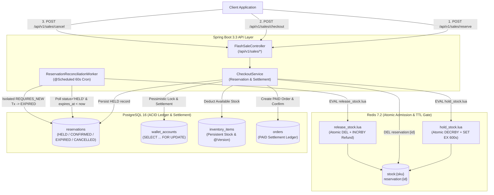

# Flash-Sale Reservation & ACID Ledger Engine

A high-concurrency **Java 21 / Spring Boot 3.3** backend engineered to handle flash-sale inventory stampedes, atomic cart holds, deterministic minor-unit wallet settlement, and automated abandoned-hold reclamation using **Redis 7.2 (Lua Scripting)** and **PostgreSQL 16**.

---

## 1. System Architecture

During a flash sale, thousands of concurrent requests compete for scarce inventory within milliseconds. Pushing every reservation attempt directly onto PostgreSQL row locks causes connection-pool exhaustion and lock contention.

This engine decouples **high-speed admission control** (handled in-memory by single-threaded Redis Lua scripts) from **durable financial settlement** (handled inside ACID PostgreSQL transactions with pessimistic row locking), backed by an asynchronous reconciliation worker that reclaims expired holds.

---

## 2. Technical Invariants & Guarantees

### Zero Overselling via Atomic Redis Lua Scripts
Standard read-modify-write patterns (`GET stock:{sku}` followed by `DECRBY stock:{sku}`) suffer from check-then-act race conditions under parallel load. To guarantee **zero overselling** before traffic ever reaches PostgreSQL:
- Reservation requests execute [`hold_stock.lua`](src/main/resources/scripts/hold_stock.lua) inside Redis via `EVAL`.
- Because Redis executes Lua scripts atomically on its single command thread, no two requests can interleave between the stock check (`current_stock < requested_qty`), the stock deduction (`DECRBY`), and the temporary hold creation (`SET reservation:{id} payload EX 600`).
- Rejected requests fail fast in sub-millisecond time with `HTTP 409 Conflict ("Item out of stock")` without acquiring a single database lock.

### Precision Accounting in Minor Units (`öre`)
Floating-point representations (`float`, `double`) cannot accurately represent base-10 monetary fractions (e.g., `0.1 + 0.2 != 0.3` in IEEE 754 binary floating point), leading to rounding drift across ledger settlements.
- Every monetary column (`inventory_items.price_minor`, `wallet_accounts.balance_minor`, `orders.total_amount_minor`) is stored as a 64-bit integer (`BIGINT` / `Long`) representing **minor currency units** (`öre` for `SEK`, where `19900` = `199.00 SEK` and `50000` = `500.00 SEK`).
- All arithmetic (`quantity * priceMinor`, `balanceMinor - totalCost`) is exact integer math with database-level `CHECK (balance_minor >= 0)` constraints.

### Concurrency Control: Pessimistic (`SELECT FOR UPDATE`) vs. Optimistic (`@Version`) Locking
The engine combines both locking strategies across the domain model based on contention profile and failure semantics:

| Mechanism | Usage in Engine | SQL / JPA Mechanism | Why Chosen |
| :--- | :--- | :--- | :--- |
| **Pessimistic Write Lock** | `WalletAccountRepository.findByUserIdForUpdate` & `InventoryItemRepository.findBySkuForUpdate` during `/checkout` | `SELECT ... FOR UPDATE` (`@Lock(LockModeType.PESSIMISTIC_WRITE)`) | Serializes concurrent checkout attempts for the same wallet at the database row level. The second concurrent thread blocks until the first commits, then immediately observes the updated `0` balance and deterministically throws `InsufficientFundsException` (`400 Bad Request`) instead of failing with a generic optimistic retry exception. |
| **Optimistic Locking** | `@Version` column on `InventoryItem` and `WalletAccount` entities | `UPDATE ... SET version = version + 1 WHERE id = ? AND version = ?` | Acts as a defense-in-depth invariant guard for non-locking administrative updates, preventing lost updates if two transactions ever modify an entity outside a pessimistic lock boundary. |
